<h1 align="center">Commune Sky</h1>

<p align="center">
  <b>The sky belongs to everyone.</b><br>
  A fast, beautiful, ad-free weather app for Android.<br>
  No accounts, no trackers, no ads — just the weather, drawn with care.
</p>

<p align="center">
  <a href="https://play.google.com/store/apps/details?id=com.alihaydarsayar.communesky"></a>
  <a href="LICENSE"></a>
  
  
  
</p>

<p align="center">
  <a href="#features">Features</a> ·
  <a href="#widgets">Widgets</a> ·
  <a href="#notifications">Notifications</a> ·
  <a href="#privacy">Privacy</a> ·
  <a href="#building">Building</a> ·
  <a href="CHANGELOG.md">Changelog</a> ·
  <a href="CONTRIBUTING.md">Contributing</a> ·
  <a href="README.tr.md">Türkçe</a>
</p>

> *Commune* — a community that shares what it has, and *to commune* — to feel close to something larger than yourself. Both fit the sky.

<p align="center">
  
  
  
  
</p>

## A sky that lives

The background is not a picture. It is drawn on your phone and follows the weather and the time of day: sun rays, a moon with its real phase, stars, drifting clouds, rain, snow, fog and lightning, with sunrise and sunset colours in between.

<p align="center">
  
</p>

## Features

| | |
|---|---|
| **Hourly and 7-day forecast** | A temperature curve for the next 24 hours, temperature-coloured daily range bars, and precipitation chance on every row. |
| **Details at a glance** | Feels-like, humidity, wind with compass, UV index, sun path, visibility, pressure, precipitation and cloud cover. Tap a tile for today's chart hour by hour, a comparison with yesterday, the week ahead and a plain explanation. |
| **For today** | What to wear in the morning, at midday and in the evening, worked out on your phone from the feels-like temperature, rain, wind and UV, and adapting to you. Everyday tips: umbrella, sunscreen, drying laundry, the best two hours for a run, car wash, stargazing. How today compares with yesterday. |
| **Air quality and the moon** | The European air quality index with pollutants and health advice (CAMS), and a moon page calculated on your phone: phase, moonrise and moonset, the next full and new moon. |
| **National forecasts and warnings** | In Türkiye: forecasts, weather warnings and seasonal normals from MGM. In France and the United Kingdom: the Météo-France and Met Office models. The app measures how accurate each source is at your place and picks the closest one by itself. |
| **Honest skies** | Clear and cloudy conditions are recomputed from sunshine duration and cloud layers, so thin high cirrus doesn't turn a sunny day "overcast". |
| **Checked against real measurements** | Current conditions are compared with the nearest weather station (MGM in Türkiye, airport reports elsewhere). In Türkiye the current temperature is worked out from the MGM stations and airports within 25 km; elsewhere a nearby station sets the current temperature and sky, and a farther one warns about storms on the way. |
| **Offline-first** | The last forecast appears instantly from the local cache, then refreshes in the background. Pull to refresh any time. A short loss of connection never throws away a recent reading. |
| **Your places** | Search any city, district or neighbourhood worldwide, save it, drag to reorder and mark one as Home. Swipe between places on the home screen. |
| **Your location, if you want it** | Approximate location shows your district; optional precise location shows your neighbourhood and picks the closest station. Without permission it shows your saved places, or Istanbul. |
| **Units, theme, language** | °C or °F, four wind units, 12 or 24-hour clock, light or dark. English, Turkish and French, with per-app language support. |
| **Smooth and accessible** | Screen transitions that fade through the sky, the system back gesture preview, 44 dp touch targets, large text and display sizes, TalkBack labels. |
| **Fast** | R8-optimised release build, Baseline Profiles for quick start-up, and Compose stability tuning for smooth animations. |

<p align="center">
  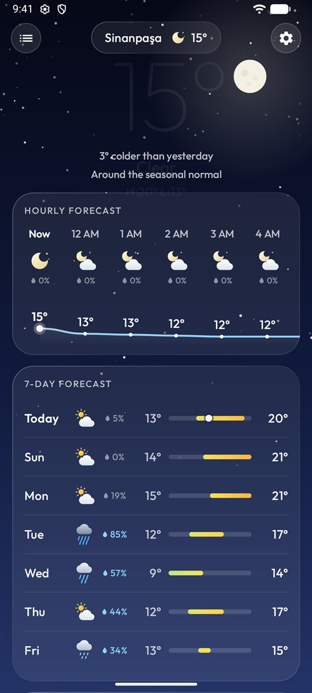
  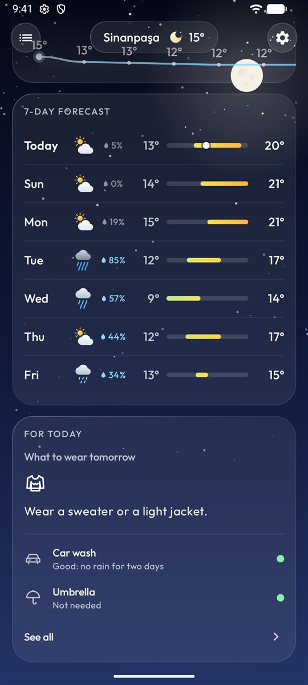
  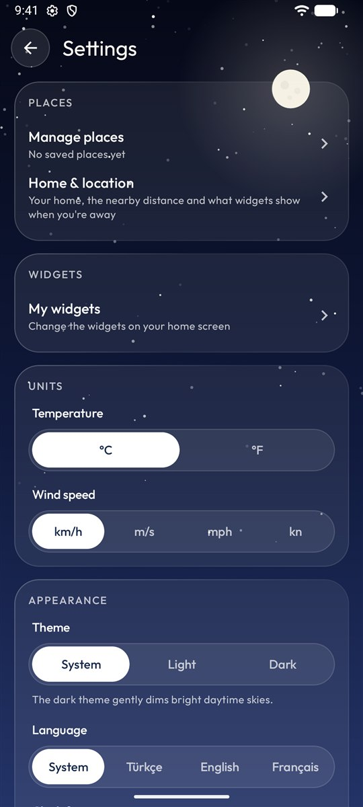
  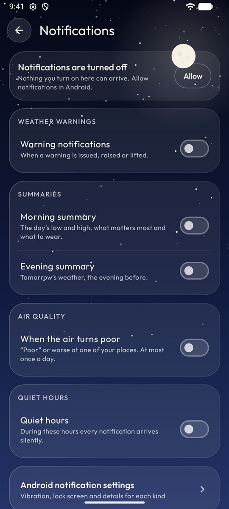
</p>

## Widgets

Ten widgets with 39 styles. Each widget has its own place, background, transparency, colours, corners and text size, with a live preview while you set it up. Every picture below is a real widget drawn by the app at its own size, with example weather for Beşiktaş, London and Paris, on the same calm wallpaper.

<p align="center">
  
</p>

### Clock

14 styles: a digital radial clock with a lit seconds ring, four analog dials, clocks with the weather, the sun or your places, and plain large type. Tapping the clock opens your clock app.

<p align="center">
  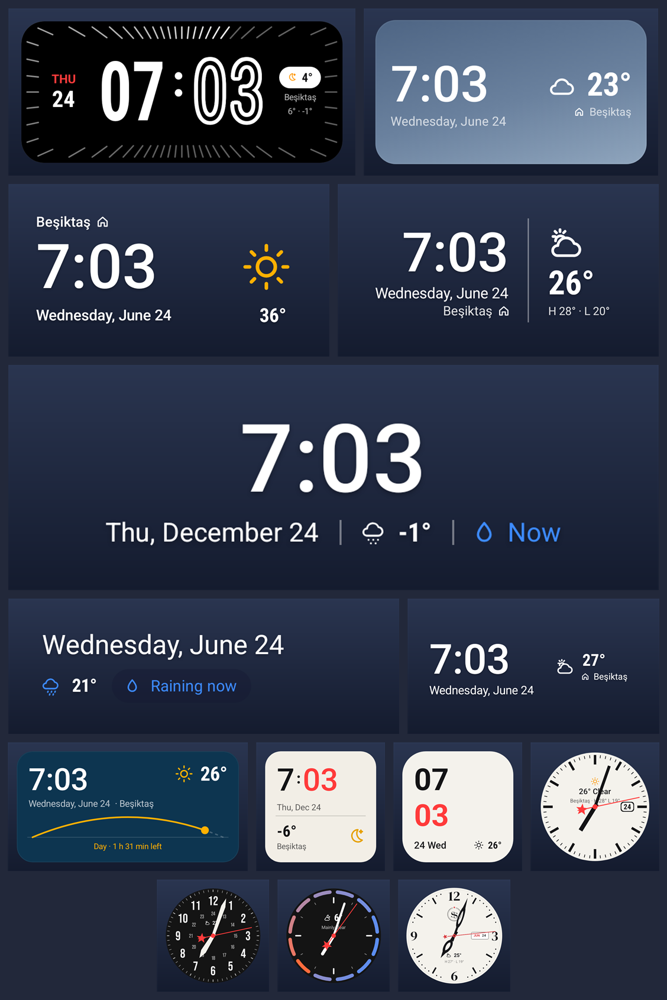
</p>

### Home & location

3 styles, each in three situations: at home, near home and away (home and where you are, side by side). Whether you are home, nearby or away is worked out on your phone.

<p align="center">
  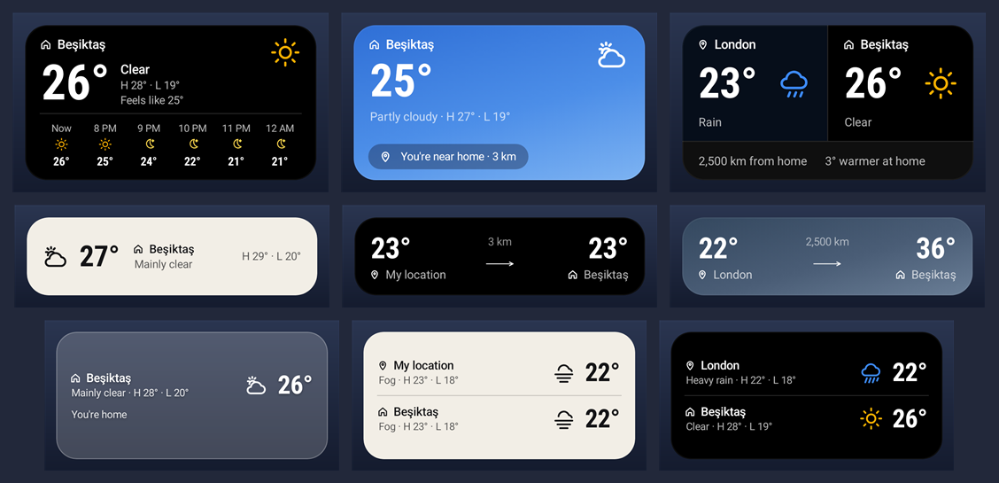
</p>

### Hourly

3 styles: a temperature curve with rain bars, icons, or a single row.

<p align="center">
  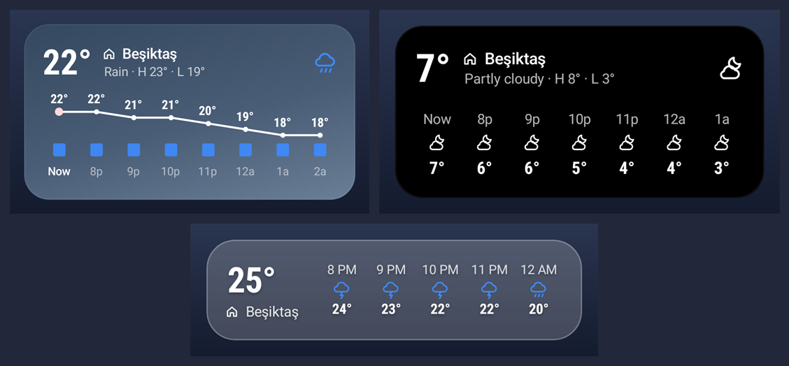
</p>

### Weekly

3 styles: range bars, columns or a list.

<p align="center">
  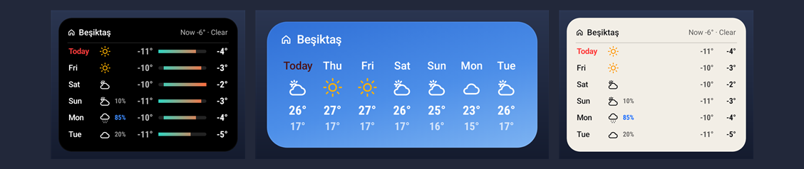
</p>

### Small

4 styles for a small spot, from classic to minimal, plus a What to wear widget.

<p align="center">
  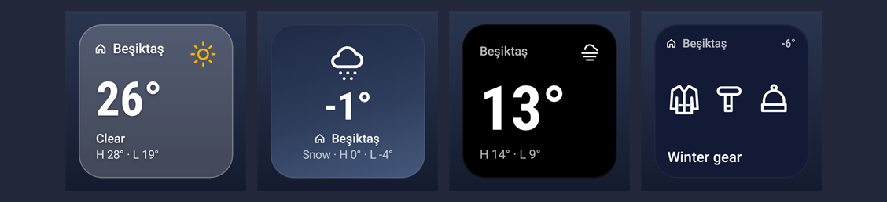
</p>

### Text

4 styles: one line or one number for a narrow spot, and a What to wear sentence.

<p align="center">
  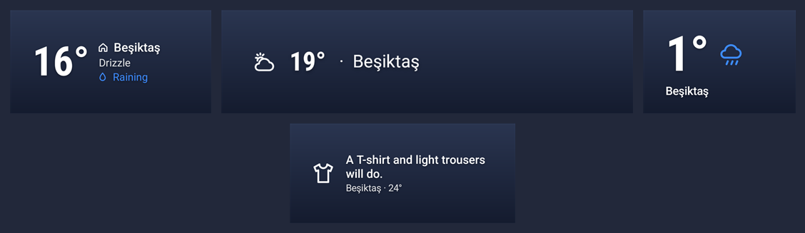
</p>

### My places

2 styles: your saved places side by side or as a list.

<p align="center">
  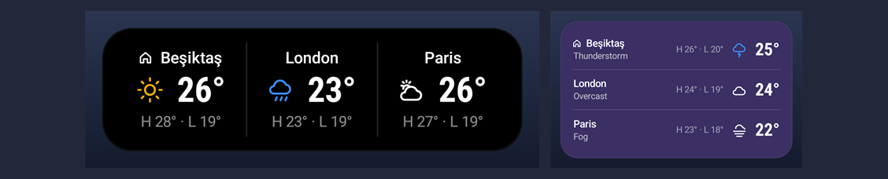
</p>

### Rain

2 styles: rain (or snow) in the next two hours, as bars or a sentence.

<p align="center">
  
</p>

### Details

3 styles: feels like, humidity, wind, UV, pressure and visibility as tiles or a list, or the sun's path.

<p align="center">
  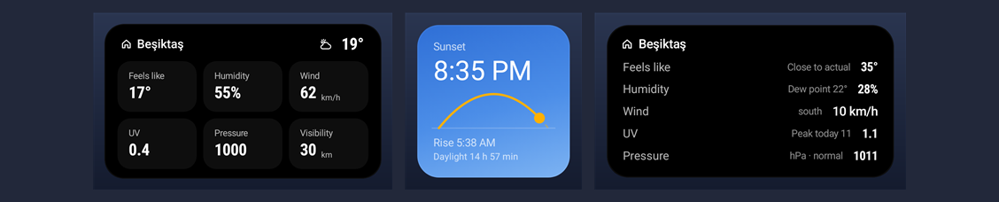
</p>

### For today

What to wear and the everyday tips at a glance.

<p align="center">
  
</p>

## Notifications

Off until you turn them on; the app asks for the notification permission only then.

- **Weather warnings** from MGM — with the warning's colour, the place, what is expected and when, and a *Details* button. Choose which levels (yellow and up, orange and up, red only) and which places (where you are, home or all saved places). A raised warning notifies again and the notification goes away when the warning is lifted.
- **Morning summary** — the day's range and its main event, morning / noon / evening at a glance, plus an optional evening summary about tomorrow.
- **Air quality** — when the air turns poor at one of your places, at most once a day.
- **Quiet hours** — silence everything at night (red warnings can still sound). Every kind of notification has its own sound and silent channels in Android's settings, named in the app's language.

## Privacy

Commune Sky has no ads, no analytics and no accounts, and the developer never receives your location, searches or saved places. To show the weather the app talks directly to:

- **Open-Meteo** (forecast, air quality and place search): coordinates of your location and saved places, rounded to about 1 km; the text you search for
- **Photon by komoot** (place search): the text you search for
- **MGM**, Turkish State Meteorological Service (forecasts, warnings and current conditions in Türkiye): rounded coordinates and the province name once to find the district and nearby stations, then district, province and station numbers
- **NOAA Aviation Weather Center** (airport reports, everywhere): an area of about 50 km around the place
- **Android Geocoder** (district and neighbourhood names, and searches as a last resort): your coordinates; the search text

Forecasts, saved places, measurements and settings are stored only on your device; nothing is kept for troubleshooting. The full policy, in English and Turkish, is at [alihaydarsayar.com/communesky/privacy](https://alihaydarsayar.com/communesky/privacy/).

## Building

Requirements: Android Studio (latest stable), JDK 17+, an Android 8.0+ (API 26) device or emulator.

```bash
git clone https://github.com/alihaydarsayar/zAhs_CommuneSky.git
```

Open the folder in Android Studio, let Gradle sync, then press **Run**. No API key is needed.

To build a release:

```bash
./gradlew :app:assembleRelease   # APK
./gradlew :app:bundleRelease     # AAB for Google Play (needs your own signing key)
```

### Testing

```bash
./gradlew :app:testDebugUnitTest          # unit tests (JVM)
./gradlew :app:lintDebug                  # lint
./gradlew :app:connectedDebugAndroidTest  # on-device tests (needs a device or emulator)
```

`WidgetSizeAuditTest` renders every widget style at many launcher sizes and takes about 40 minutes, so the default on-device run skips it (it is marked `@SlowAudit`). Run it on its own with:

```bash
./gradlew :app:connectedDebugAndroidTest -PslowAudit -Pandroid.testInstrumentationRunnerArguments.class=com.alihaydarsayar.communesky.widget.WidgetSizeAuditTest
```

The debug build also has helpers that are not compiled into release builds: a fake network failure, fake weather warnings and a button to send the summaries at once. See [CONTRIBUTING.md](CONTRIBUTING.md).

## Tech stack

Kotlin · Jetpack Compose · Material 3 · MVVM · Hilt · Retrofit + kotlinx.serialization · Room · DataStore · WorkManager · Jetpack Glance · Navigation Compose · Fused Location Provider · Baseline Profiles

## Credits

- Weather data by [Open-Meteo.com](https://open-meteo.com/), licensed under [CC BY 4.0](https://creativecommons.org/licenses/by/4.0/).
- In Türkiye, forecasts, weather warnings, seasonal normals and station measurements from the [Turkish State Meteorological Service (MGM)](https://www.mgm.gov.tr/).
- ECMWF forecasts (IFS and AIFS) through Open-Meteo: © [ECMWF](https://www.ecmwf.int/en/forecasts/datasets/open-data), licensed under [CC BY 4.0](https://creativecommons.org/licenses/by/4.0/).
- In France, [Météo-France](https://meteofrance.com/) models (AROME, ARPEGE; [Etalab Open Licence 2.0](https://www.etalab.gouv.fr/licence-ouverte-open-licence/)); in the United Kingdom and Ireland, [Met Office](https://www.metoffice.gov.uk/) models (UKV, global; © Crown copyright, [CC BY-SA 4.0](https://creativecommons.org/licenses/by-sa/4.0/)); both through Open-Meteo.
- Air quality from the [Copernicus Atmosphere Monitoring Service (CAMS)](https://atmosphere.copernicus.eu/) through the [Open-Meteo Air Quality API](https://open-meteo.com/en/docs/air-quality-api), licensed under [CC BY 4.0](https://creativecommons.org/licenses/by/4.0/).
- Airport reports (METAR) from the [NOAA Aviation Weather Center](https://aviationweather.gov/).
- Place search by [Photon](https://photon.komoot.io/) (komoot), using data © [OpenStreetMap](https://www.openstreetmap.org/copyright) contributors, and [Open-Meteo Geocoding](https://open-meteo.com/en/docs/geocoding-api).
- [Outfit](https://github.com/Outfitio/Outfit-Fonts) typeface, licensed under the [SIL Open Font License 1.1](third_party/Outfit-OFL.txt).
- Clock digits derived from Bebas Neue (SIL Open Font License 1.1), see [third_party/BebasNeue-OFL.txt](third_party/BebasNeue-OFL.txt).

## License

Commune Sky is free software, released under the [GNU General Public License v3.0](LICENSE). You are free to use, study, share and improve it — and anything built from it must stay free too.

Copyright © 2026 Ali Haydar Sayar
