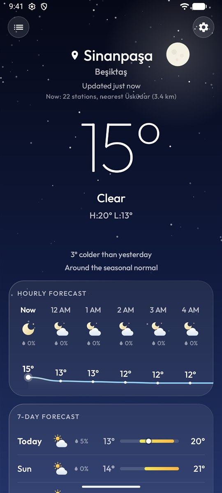
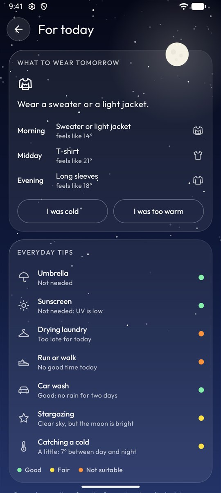
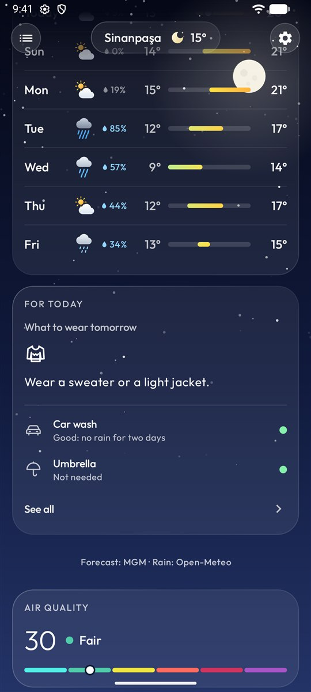
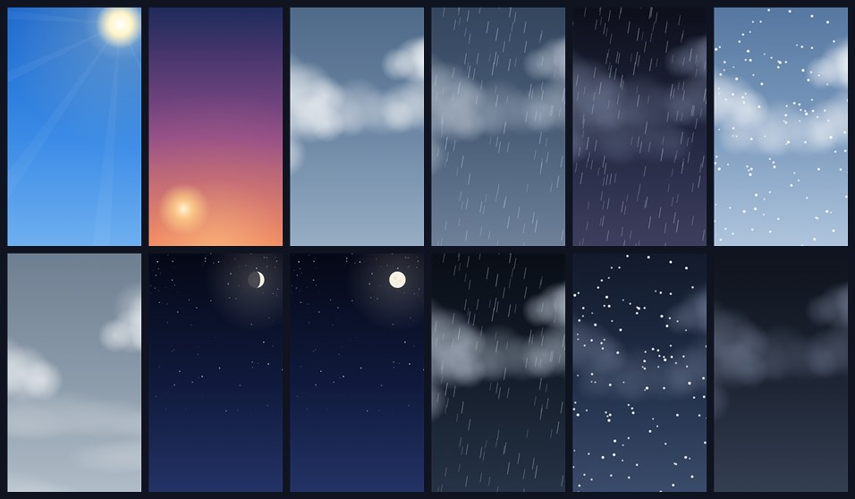
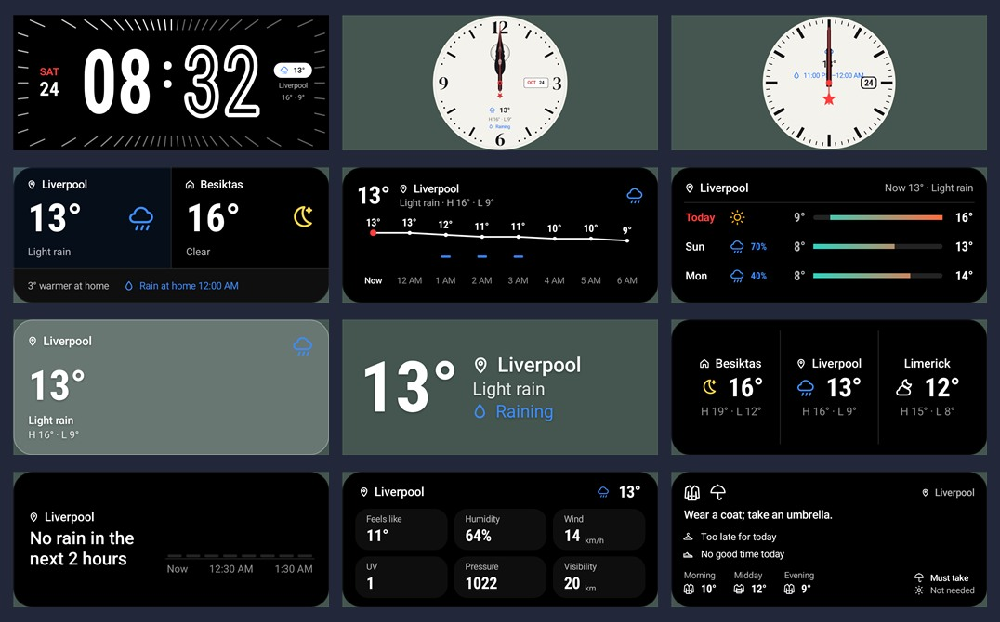

<h1 align="center">Commune Sky</h1>

  <b>Gökyüzü herkesindir.</b> 
  Android için hızlı, güzel ve reklamsız bir hava durumu uygulaması. 
  Hesap yok, izleyici yok, reklam yok — yalnızca özenle çizilmiş hava durumu.

  
  
  

<a href="README.md">English</a> · <a href="CHANGELOG.md">Değişiklikler (İngilizce)</a> · <a href="CONTRIBUTING.md">Katkı</a>

  
  
  
  

## Yaşayan bir gökyüzü

Arka plan bir resim değil, telefonunda çizilir ve havayı ve günün saatini izler: güneş ışınları, gerçek evresiyle ay, yıldızlar, süzülen bulutlar, yağmur, kar, sis ve şimşek; arada gün doğumu ve batımı renkleri.

## Özellikler

- **Saatlik ve 7 günlük tahmin** — 24 saatlik sıcaklık eğrisi, sıcaklığa göre renklenen günlük aralık çubukları, her satırda yağış ihtimali.
- **Ayrıntılar** — hissedilen sıcaklık, nem, pusulalı rüzgâr, UV, güneşin yolu, görüş, basınç, yağış ve bulut. Bir kutucuğa dokununca saat saat grafik, dünle karşılaştırma ve sade bir açıklama.
- **Bugün için** — sabah, öğle ve akşam ne giymeli (telefonunda hesaplanır, sana uyum sağlar); şemsiye, güneş kremi, çamaşır, koşu, araba yıkama ve yıldız gözlemi önerileri.
- **Hava kalitesi ve ay** — Avrupa hava kalitesi endeksi ve sağlık önerileri; ayın evresi, doğuş ve batış saatleri.
- **Ulusal tahminler ve uyarılar** — Türkiye'de MGM'den tahmin, uyarı ve mevsim normalleri; Fransa ve Birleşik Krallık'ta ulusal modeller. Uygulama her kaynağın yerinde ne kadar doğru olduğunu ölçer ve en yakınını kendisi seçer.
- **Gerçek ölçümlerle kontrol** — anlık durum, en yakın istasyonla karşılaştırılır (Türkiye'de MGM, başka yerlerde havalimanı raporları).
- **Çevrimdışı çalışır** — son tahmin anında açılır, arka planda yenilenir.
- **Yerlerin** — dünyadaki her şehir, ilçe ya da mahalleyi ara, kaydet, sırala, birini Ev yap.
- **Widget'lar** — on widget, 39 stil: saatler, saatlik eğri, haftalık aralık çubukları, önümüzdeki iki saatte yağmur, ayrıntılar ve dahası. Her widget'ın kendi yeri, arka planı, saydamlığı, renkleri, köşeleri ve yazı boyutu vardır.
- **Bildirimler** — varsayılan kapalı; MGM uyarıları, sabah ve akşam özeti, kötü hava kalitesi ve sessiz saatler.
- **Türkçe, İngilizce ve Fransızca**; uygulama başına dil desteği.

  

## Gizlilik

Reklam, analiz ve hesap yoktur; geliştirici konumunu, aramalarını ya da kayıtlı yerlerini hiç almaz. Tahminler, kayıtlı yerler, ölçümler ve ayarlar yalnızca telefonunda saklanır; sorun giderme için hiçbir şey tutulmaz. Tam metin: [alihaydarsayar.com/communesky/privacy](https://alihaydarsayar.com/communesky/privacy/).

## Derleme

Android Studio'da klasörü açıp **Run**'a bas. API anahtarı gerekmez. Ayrıntılar için [README.md](README.md#building) ve [CONTRIBUTING.md](CONTRIBUTING.md).

## Lisans

GNU GPL v3.0 — [LICENSE](LICENSE). Telif © 2026 Ali Haydar Sayar. Veri kaynakları ve yazı tipleri için [Credits](README.md#credits).
